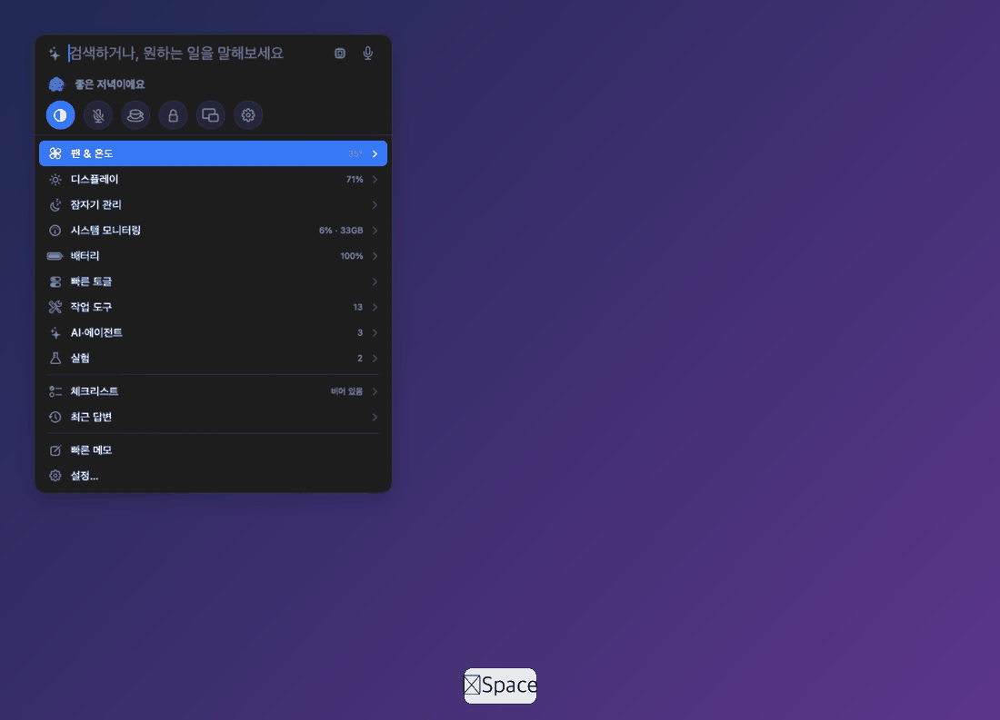
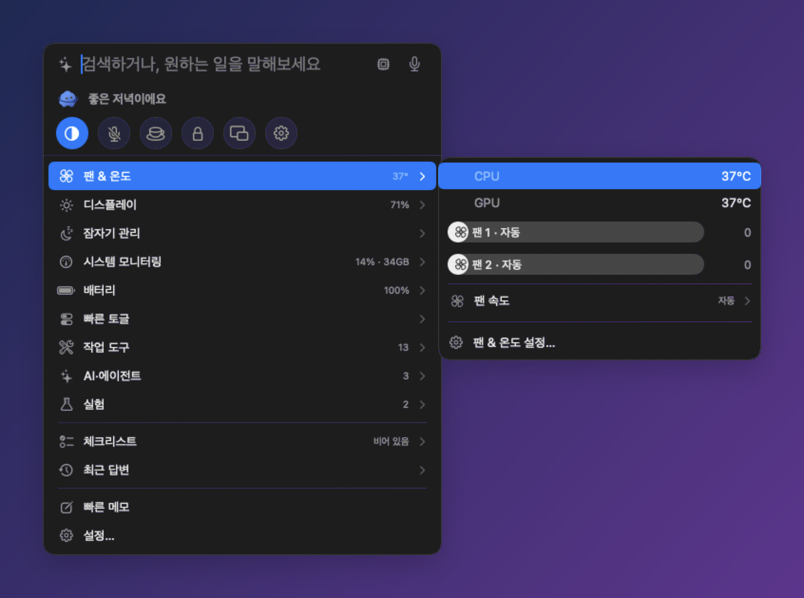
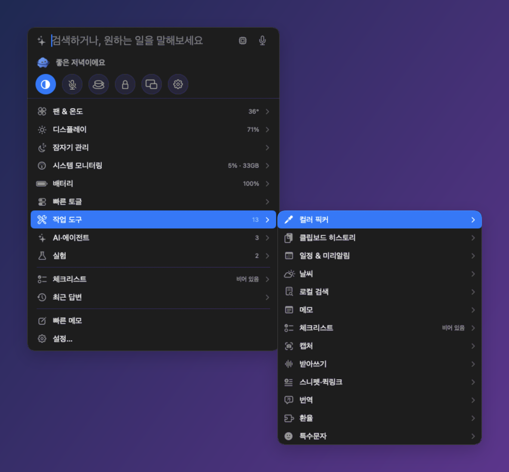
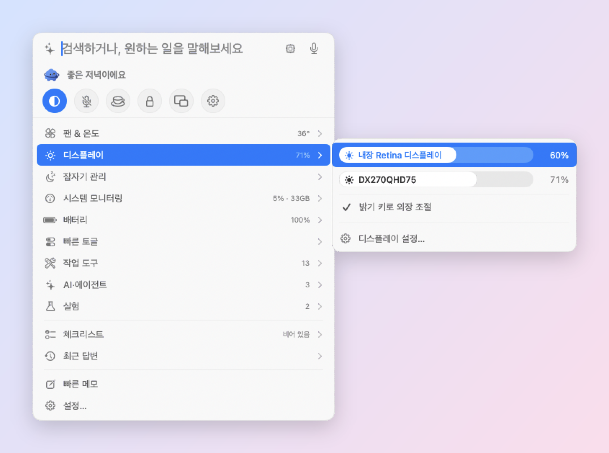
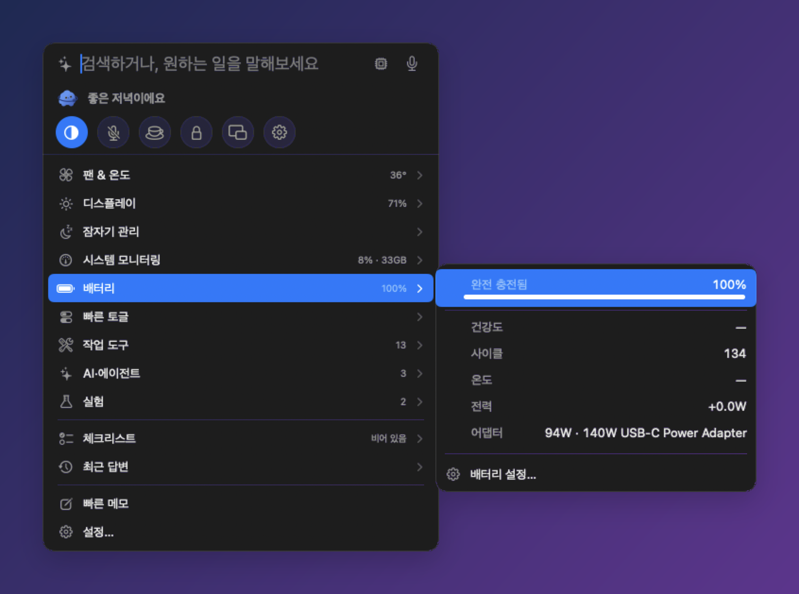
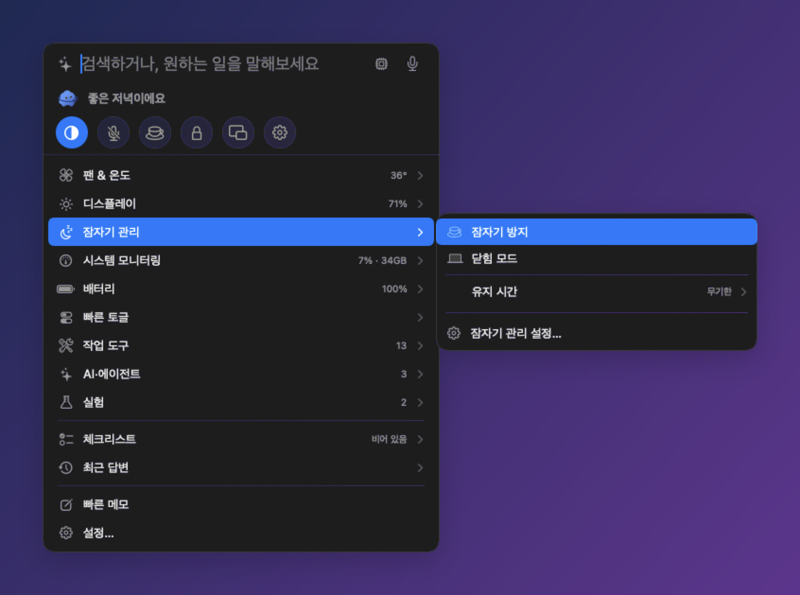
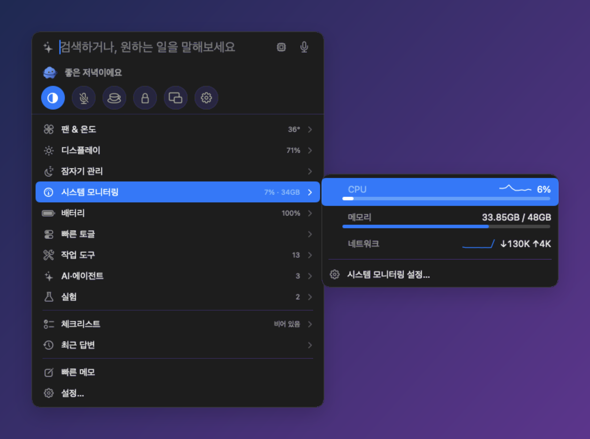
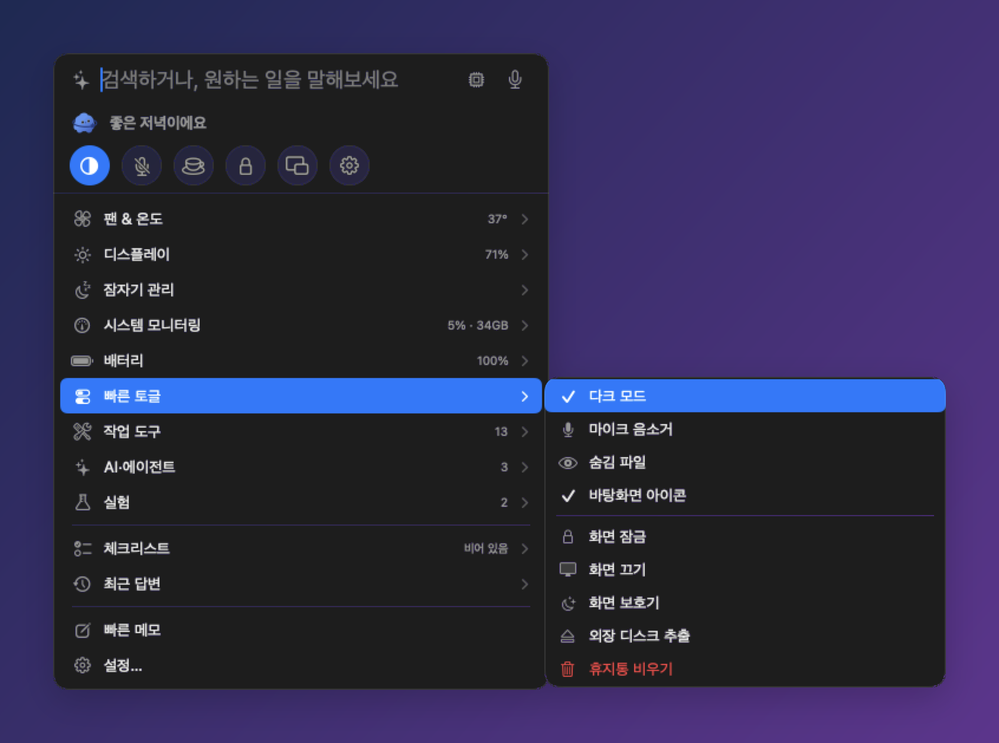
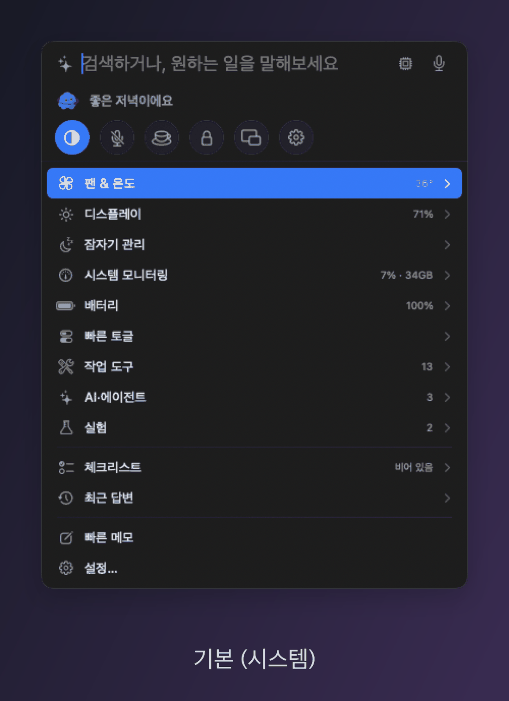
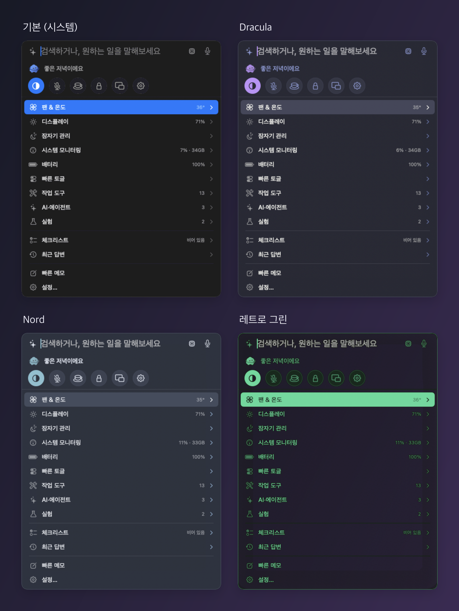

[English](README.md) · **한국어**

# Divee

**Mac의 자잘한 설정을 메뉴바 하나에서, ⌥Space 한 번으로.**

팬·온도, 밝기, 배터리, 잠자기, 키 바꾸기, 클립보드까지 한곳에 모은 무료 메뉴바 유틸리티입니다. 
메뉴바에는 작은 마스코트가 삽니다 — 기본은 다이비, 원하면 고양이로 바꿀 수 있어요.

[즉석 카드](#-즉석-카드) · [사용법](#-사용법) · [기능 자세히](#-기능-자세히) · [AI 도우미](#-ai-도우미) · [테마](#-테마) · [단축키](#%EF%B8%8F-단축키) · [DevDive](#-devdive-연동-준비-중) · [설치](#-설치) · [믿고 쓰기](#%EF%B8%8F-믿고-쓸-수-있게)

 

⌥Space로 열고 ↓ → 만으로 "잠자기 관리 › 유지 시간 › 30분"까지 들어가는 모습

---

## ✨ 이런 앱이에요

- **⌥Space 한 번이면 끝.** 입력창 아래 한 줄짜리 목록에서 항목에 마우스를 올리거나 → 를 누르면, Windows 우클릭 메뉴처럼 **옆으로 펼쳐집니다.** 최대 3단까지 이어집니다.
- **키보드만으로도 다 됩니다.** ↑↓ 이동 · → 펼치기 · ← 접기 · Return 실행 · ESC 닫기. 조절바는 ←/→ 로 움직입니다.
- **원하는 기능만 켭니다.** 모듈과 플러그인 중 필요한 것만 켜고, 꺼 둔 모듈은 아예 돌지 않습니다. 처음에는 시스템 모니터링 · 배터리 · 팬 & 온도 · 체크리스트 4개만 켜져 있습니다.
- **가볍습니다.** 패널이 닫혀 있을 때 CPU 약 0.2%·메모리 약 42MB, 열어 둬도 CPU 약 1%. 앱 크기는 13MB 입니다. 애니메이션은 macOS 기본 방식만 쓰고, 설정에서 끌 수 있습니다.
- **기본은 이 Mac 안에서만.** AI도 이 Mac 안의 모델을 먼저 씁니다. 밖으로 데이터를 보내는 기능은 켰을 때만 동작하고, 설정에 그대로 표시됩니다.

## ⚡ 즉석 카드

입력창에 한 줄을 치면 **Enter를 누르기 전에** 바로 카드로 바뀝니다. AI 없이 이 Mac 안에서 계산하고, 한글을 조합하는 중에도 바로 반영됩니다.

| 입력 | 카드 |
|---|---|
| `3pm pst in ist`, `뉴욕 지금 몇 시` | 시간대 변환 (다음 날 표시) |
| `24000원 3명`, `3450의 18%`, `72f to c`, `3평 제곱미터` | 나누기 · 퍼센트 · 단위 변환 |
| `크리스마스까지`, `100일 뒤` | 날짜 · 디데이 |
| `부산 날씨`, `내일 비 와?` | 날씨 (날씨 모듈을 켠 경우) |
| `내일 일정`, `내일 3시 회의` | 일정 조회 · 등록 — 상세는 패널 안에서 옆으로 펼쳐 봅니다 |
| `우유, 계란, 빵 사기` | 체크리스트 → 미리 알림 |
| `25분 집중` | 타이머 — 메뉴바에 남은 시간, 패널 안에서 일시정지·연장·취소 |
| `#ff6b35`, `하늘색` | 색상 (HEX · RGB · HSL 복사) |
| `dkssudgktpdy` | 한영 오타 → 안녕하세요 |
| `맥 느려`, `사파리 종료` | CPU 많이 쓰는 앱 · 앱 종료 |
| `밝기 50`, `팬 최대`, `잠자기 30분` | 기능 바로 조절 (Return으로 실행) |
| `클로드 사용량`, `codex 한도` | AI 사용량 (Claude Code · Codex 한도) |
| `체크리스트` | 체크리스트 — 입력창이 "항목 추가"가 되고, 체크하면 취소선 |
| `설정`, `블루투스 설정`, `와이파이` | 시스템 설정의 해당 화면 바로 열기 |
| `테마 노드로`, `애니메이션 꺼` | 말로 Divee 설정 바꾸기 (마스코트가 알려 주고 되돌리기) |
| `오른쪽 커맨드로 한영 전환`, `캡스락 짧게 esc 길게 컨트롤`, `캡스락을 esc로` | 키 바꾸기 카드·단순 키 바꾸기 (Return으로 실행, 되돌리기) |
| `폴더 중에서 이름 보고서인 거 찾아줘`, `9월 1일부터 15일까지 만든 폴더` | 파일 찾기 — 종류·이름·위치·기간, 어떻게 알아들었는지 함께 표시 |
| `피드백 …`, `버그 …` | 피드백 보내기 — 내용이 채워진 GitHub 이슈가 열리고, 직접 제출하기 전엔 아무것도 보내지 않음 |

**문장으로 말해도 됩니다.** 규칙에 안 걸리면 Mac 안의 작은 분류기(24 KB)가 어떤 카드를 원하는지 골라 줍니다 — `화면 좀 어둡게`, `야간 모드로 바꿔줘`, `노션 좀 꺼줘`. 이렇게 나온 카드엔 **✦ 온디바이스** 표시가 붙고, 확신이 없으면 카드를 띄우지 않습니다.

## 🛡️ 믿고 쓸 수 있게

| | |
|---|---|
| **Apple 공증** | Developer ID로 서명하고 Apple 공증을 마쳤습니다. 경고 없이 열립니다. |
| **백그라운드 도우미** | 팬 속도 조절과 닫힘 모드에만 필요합니다. macOS 기본 백그라운드 항목으로 등록되고, 시스템 설정 › 일반 › 로그인 항목에서 **한 번만** 승인하면 됩니다. 하는 일은 팬 속도 지정·자동 복귀, `pmset disablesleep` 켜고 끄기, 스스로 지우기 — 이것뿐입니다. Divee와 도우미가 서로의 코드 서명을 확인하고, Divee가 멈추면 도우미가 **30초 안에 팬을 자동으로 되돌리고 닫힘 모드를 끕니다.** Divee가 업데이트되면 도우미도 알아서 새 버전으로 바뀝니다 — 다시 승인할 필요 없음. |
| **키 입력은 Mac 안에서만** | 키 규칙은 네트워크에 닿을 수 없는 별도의 샌드박스 프로세스에서 처리합니다. Divee에는 "한/영 전환" 같은 할 일만 전하고, 어떤 키를 눌렀는지는 전하지 않습니다. |
| **위험한 작업은 먼저 묻기** | AI가 되돌리기 어려운 일 — 파일 열기, 단축어 실행, 화면 누르기, 디스크 추출 같은 것 — 을 하려 하면 마스코트가 무엇을 할지 보여 주고 기다립니다: **↩ 실행, ESC 취소.** |
| **서명된 업데이트** | 업데이트 파일과 업데이트 목록(피드) 모두 서명(EdDSA)돼 있습니다. 새 버전이 나오면 알려만 주고, 직접 설치를 누르기 전엔 아무것도 설치하지 않습니다. |
| **모으지 않는 것** | 사용 통계·분석·광고 추적이 없습니다. 키보드 입력을 기록하지 않고, 화면·카메라는 요청한 순간 한 장만 보고 저장하지 않습니다. |
| **밖으로 나가는 것** | 켠 기능만, 정해진 곳으로만 — 아래 [개인정보](#-개인정보) 표에 전부 있습니다. |
| **깨끗하게 지우기** | 설정 › 팬 & 온도 › **도우미 제거**를 누르면 팬·잠자기 설정을 원래대로 돌리고 도우미를 지웁니다. 그다음 앱을 휴지통으로 옮기면 끝입니다. |

## 🧭 사용법

### 패널 열기

| 방법 | 동작 |
|---|---|
| **⌥Space** | Divee 패널 열기·닫기 |
| 메뉴바 마스코트 **클릭** | 같은 패널을 엽니다 |
| 메뉴바 마스코트 **우클릭** | 설정… · 플로팅 패널 고정 · 피드백 보내기… · 업데이트 확인… · Divee 종료 |

### 첫 화면 구성

입력창 아래에 한 줄씩 나옵니다. 줄 오른쪽 흐린 글자는 지금 값이고, `›`가 있으면 옆으로 펼쳐집니다.

- **시스템 모듈**(팬 & 온도, 디스플레이, 잠자기, 시스템 모니터링, 배터리)은 바로 보입니다.
- **빠른 토글 ›** — 다크 모드 같은 스위치 모음
- **작업 도구 ›**, **AI·에이전트 ›**, **실험 ›** — 켜 둔 모듈들이 분류별로 묶여 있습니다
- **최근 답변 ›** — AI에게 물어본 기록
- **빠른 메모** · **설정…**

### 키보드

| 키 | 동작 |
|---|---|
| ↑ ↓ | 지금 열(column) 안에서 이동 |
| → 또는 Return | 펼치기 (펼침 칸의 첫 항목으로 이동) |
| ← | 한 단계 접기 · 조절바 줄에서는 값 낮추기 |
| → (조절바 줄) | 값 올리기 |
| Return | 실행 · 토글 켜고 끄기 · 선택지 고르기 |
| ESC | 가장 깊은 펼침부터 닫기 → 입력 지우기 → 패널 닫기 |
| ⌘↩ | 검색 결과의 앱·파일을 Finder에서 보기 |

### 검색하기

입력창에 글자를 치면 목록이 검색 결과로 바뀝니다.

| 결과 | 설명 |
|---|---|
| 기능 | 켜 둔 모듈과 모듈 명령(예: "팬 최대로", "밝기 올리기") |
| AI | 문장을 그대로 AI에게 묻기 |
| 앱 · 파일 | Spotlight로 찾은 앱과 파일. 문장으로도 됩니다: `폴더 중에서 이름 보고서인 거 찾아줘`, `다운로드 폴더에서 이번 주 받은 사진`, `8월에 받은 pdf`, `9월 1일부터 15일까지 만든 폴더` — 캐시·빌드 폴더는 빼고 보여 줍니다 |
| 메모 | Apple 메모에서 찾은 메모 |
| 사전 | macOS 사전의 뜻풀이 |
| 계산 | `12*34` 같은 식의 결과 (Return으로 복사) |
| 웹 | 브라우저로 웹 검색 |

## 🧰 기능 자세히

각 모듈은 설정 › **기능**에서 켜고 끕니다. 제목을 누르면 자세한 설명이 펼쳐집니다.

### 시스템

<b>팬 & 온도</b> — CPU·GPU 온도와 팬 속도, 직접 조절까지 <i>(기본 켜짐)</i>

- **패널:** CPU·GPU 온도, 팬마다 조절바(막대 안에 "팬 1", 오른쪽에 RPM). 끌어서 놓으면 그 팬이 수동이 됩니다. **팬 속도 ›** 에서 자동 · 최대 · 온도 연동을 고릅니다.
- **설정:** 메뉴바 온도 표시, 경고 온도와 알림, 갱신 주기, 온도 연동의 최소·최대 온도, 도우미 설치·제거.
- **AI에게:** "팬 상태 어때?", "팬 속도 최대로", "팬 자동으로 돌려놔", "온도 연동 켜 줘"
- 온도·RPM 읽기는 권한 없이 됩니다. **팬 속도를 바꾸려면** 백그라운드 도우미가 필요합니다 — 시스템 설정 › 일반 › 로그인 항목에서 한 번 승인하세요.

<b>디스플레이</b> — 내장·외장 모니터 밝기

- **패널:** 화면마다 제어 센터식 조절바(막대 안에 모니터 이름). 외장 모니터는 DDC/CI로 조절합니다.
- **밝기 키로 외장 조절:** 키보드 밝기 키(F1/F2)로 외장 모니터도 조절합니다. 손쉬운 사용 권한이 필요합니다.
- **설정:** 클릭한 화면 자동 선택, 밝기 키 연동.
- **AI에게:** "밝기 50으로", "지금 밝기 몇이야?"

<b>키 바꾸기</b> — Karabiner 같은 키 규칙을 쉽게

- **"하고 싶은 일" 카드** (설정 › 키 바꾸기) — 켜면 바로 적용됩니다:
  - **한/영 전환 키, 지연 없이** — 오른쪽 ⌘(또는 Caps Lock, 오른쪽 ⌥, 한국어 키보드의 한/영 키)를 짧게 누르면 바로 바뀝니다. 바꾼 직후 친 첫 글자도 씹히지 않습니다. 시스템의 '이전 입력 소스' 단축키가 꺼져 있어도, 구름 입력기여도 됩니다.
  - **Caps Lock: 짧게 = Esc, 길게 = Control** (짧게 눌러 한/영 전환도 가능)
  - **Hyper 키** — Caps Lock이나 오른쪽 ⌥를 누르고 있으면 ⌃⌥⇧⌘
  - **윈도 키보드** — 고른 외장 키보드만 ⌥와 ⌘ 자리 바꾸기
  - **₩ 대신 `** — 한글 입력 중에도 백틱
  - 앱별 규칙, 짧게/길게 기준 시간(기본 300ms), "바로 시험해 보기" 칸
- **키보드 그림** (설정 › 키 바꾸기) — 그려진 키보드에서 키를 눌러 그 키가 할 일을 고릅니다. 누른 키는 그림에서 불이 켜지고, 카드가 이미 쓰는 키는 표시됩니다.
- **말로:** `오른쪽 커맨드로 한영 전환`, `캡스락 짧게 esc 길게 컨트롤`, `캡스락 하이퍼` — 되돌리기 가능
- **Karabiner 가져오기:** 단순 키 바꾸기는 그대로, 복잡한 규칙은 카드로 바꿀 수 있는 것만 보여 주고 확인받은 뒤 적용합니다. 셸 명령·앱 실행은 절대 가져오지 않고, 파일은 바꾸지 않습니다.
- **고급:** 키 하나를 다른 키로(Caps Lock → Esc, 왼쪽 ⌥ ↔ ⌘ 등) — macOS 기본 `hidutil` 사용
- **안전하게:** 키는 네트워크가 막힌 별도의 샌드박스 프로세스에서만 처리합니다. 양쪽 ⇧를 2초 누르면 규칙이 모두 꺼집니다. Divee가 꺼지거나 멈추면 — 강제 종료해도 — 작은 키 지킴이가 1초 안에 키를 원래대로 돌려놓습니다(백그라운드 도우미는 30초 안에 한 번 더 받쳐 줍니다). 암호 입력 칸에서는 쉽니다. 카드는 손쉬운 사용 권한이 필요합니다(밝기 키와 같은 권한). 단순 키 바꾸기는 권한이 필요 없습니다.

<b>배터리</b> — 잔량·건강도·사이클·전력 <i>(기본 켜짐)</i>

- **패널:** 충전 상태와 잔량 막대, 건강도 · 사이클 · 온도 · 전력(들어오는/나가는 W) · 연결된 어댑터.
- **설정:** 완충·부족 알림, 갱신 주기.
- **AI에게:** "배터리 어때?"

<b>잠자기 관리</b> — 잠자기 방지와 덮개 닫아도 켜 두기

- **패널:** ✓ 잠자기 방지, ✓ 닫힘 모드(덮개를 닫아도 계속 켜 둠), **유지 시간 ›** 무기한 · 30분 · 1 · 2 · 4시간.
- **설정:** 시간 지정, "화면도 켜 둠".
- **AI에게:** "30분 동안 잠자기 막아 줘", "덮개 닫아도 안 꺼지게"
- 닫힘 모드도 같은 백그라운드 도우미를 씁니다(로그인 항목에서 한 번 승인). 켤 때 발열 주의 안내가 나오고, Divee를 끄거나 Divee가 멈추면 저절로 꺼집니다.

<b>시스템 모니터링</b> — CPU·메모리·네트워크·디스크 <i>(기본 켜짐)</i>

- **패널:** CPU(막대 + 최근 흐름 그래프), 메모리 막대, 네트워크(다운로드 그래프 + 속도), 업타임, 디스크 남은 공간.
- **설정:** 패널·메뉴바에 보일 항목, CPU·메모리 경고 기준, 갱신 주기(1 · 2 · 5초).
- **AI에게:** "맥이 왜 이렇게 느려?"

<b>빠른 토글</b> — 자주 쓰는 스위치 모음

- **켜고 끄기:** 다크 모드 · 마이크 음소거 · 숨김 파일 보기 · 바탕화면 아이콘
- **바로 실행:** 화면 잠금 · 화면 끄기 · 화면 보호기 · 외장 디스크 추출 · 휴지통 비우기(확인 후)
- **AI에게:** "다크 모드 켜 줘", "화면 잠가 줘"
- 다크 모드·휴지통은 자동화(시스템 이벤트·Finder) 권한을 씁니다.

### 작업 도구

<b>클립보드 히스토리</b> — 복사한 것 다시 꺼내기

- 텍스트와 이미지를 최근 20개까지 기록하고, 누르면 다시 복사합니다(이미지는 합계 15MB까지).
- **바로 붙여넣기:** 항목을 고르면 쓰던 앱에 바로 붙여넣습니다(손쉬운 사용 권한 필요, 없으면 복사만 합니다).
- **고정:** 텍스트 10개까지 맨 위에 고정해 두면 Divee를 꺼도 남습니다.
- **검색:** 패널에 복사했던 글 일부를 치면 "붙여넣기 · …" 결과가 나옵니다.
- **서식 없이 붙여넣기** — 명령이며, 설정 › 단축키에서 단축키도 정할 수 있습니다.
- 명령: 기록 비우기
- **AI에게:** "아까 복사한 거 다시 복사해 줘"

<b>메모</b> — 한 줄 빠른 메모 (⌃⌥J)

- **⌃⌥J**를 누르면 한 줄짜리 입력창이 뜨고, 적은 내용이 Apple 메모의 "빠른 메모"에 시각과 함께 들어갑니다.
- **AI에게:** "회의록 메모 찾아 줘", "내일 살 것 메모해 둬"
- 메모 앱을 다루기 위해 자동화 권한을 씁니다.

<b>컬러 픽커</b> — 화면 색 추출 (⌥⌘C)

- 화면 어디든 색을 찍어 HEX 값을 클립보드에 복사합니다. 최근 8개 색이 남습니다.

<b>특수문자</b> — 자주 쓰는 기호를 한 번에 <i>(플러그인)</i>

- 이제 기본 포함 [플러그인](#플러그인)입니다 — 전에 켜 두었다면 그대로 켜져 있습니다.
- 기호를 누르면 바로 복사됩니다. Mac 키 기호 **⌘ ⌥ ⌃ ⇧ ⇪ ⇥ ⏎ ⌫ ⌦ ⎋ ⏏**도 들어 있습니다 — 표준 유니코드라 다른 운영체제의 메시지·문서에 붙여 넣어도 보입니다.
- 설정에서 목록을 자유롭게 고칠 수 있습니다(**기본값 복원**을 누르면 전체 목록이 돌아옵니다).

<b>환율</b> — 입력하면서 바로 환산 <i>(플러그인, 기본 꺼짐)</i>

- 기본 포함 [플러그인](#플러그인)입니다. 패널에 `100달러`, `5만원 달러로`, `$100`, `100 usd in krw`처럼 치면 환산한 금액이 카드로 나오고, `달러 환율`이라고 치면 환율을 보여 줍니다.
- 환율은 유럽중앙은행 기준(frankfurter.dev)이고, 통화 코드만 보내며 6시간 동안 저장해 둡니다. 인터넷이 안 되면 저장해 둔 값을 날짜와 함께 보여 줍니다.
- 바꿀 통화를 안 적었을 때 쓸 통화는 플러그인 설정에서 고릅니다.

<b>체크리스트</b> — 패널 안 간단한 할 일 목록 하나 <i>(기본 켜짐)</i>

- `체크리스트`라고 치면 입력창이 "항목 추가"가 되고, 누르면 체크되며 취소선이 그어집니다. 다 하면 **완료 지우기**나 **비우기**로 정리합니다.
- 이 Mac에만 저장됩니다 — 동기화 없음.

<b>창 맞추기</b> — Magnet처럼 창을 반쪽·사분면·1/3에 맞추기

- **배치 18가지:** 왼쪽 · 오른쪽 · 위 · 아래 반, 네 모서리, 1/3과 2/3, 최대화, 가운데, 원래 위치로, 다음 · 이전 디스플레이.
- **전역 단축키:** 배치마다 Magnet 같은 단축키가 있습니다(예: ⌃⌥← 왼쪽 반, ⌃⌥↩ 최대화, ⌃⌥⌫ 원래 위치로). 왼쪽 아래는 ⌃⌥J가 빠른 메모라서 기본값이 없습니다. 모듈 설정에서 모두 바꿀 수 있습니다.
- **⌥Space 패널 메뉴:** 패널에서 배치를 고르면 방금까지 쓰던 창에 적용됩니다.
- **창 레이아웃 저장:** 지금 창 배치를 저장하고("창 레이아웃 저장") 나중에 되돌립니다("레이아웃 복원 · 이름").
- 손쉬운 사용 권한을 씁니다. 기본 꺼짐.

<b>캡처</b> — 스크린샷 · 글자 캡처 · 화면 녹화

- **패널:** 영역 캡처 · 영역 캡처 → 클립보드 · 창 캡처 · 전체 화면 캡처 · 캡처 도구 막대 · 화면 녹화 — macOS 기본 `screencapture`를 씁니다.
- **글자 캡처:** 화면의 영역을 고르면 그 안의 글자를 이 Mac 안에서 읽어 복사합니다.
- **최근 캡처:** 열기 · Finder에서 보기 · 이미지 복사. **최근 녹화를 GIF로**로 가장 최근 녹화를 GIF로 바꿉니다.
- 영역 캡처와 글자 캡처의 단축키는 설정 › 단축키에서 정합니다. 화면 기록 권한이 필요합니다. 기본 꺼짐.

<b>받아쓰기</b> — 어디서나 키를 누르고 말하기

- 모듈 설정에서 단축키를 정합니다(기본값 없음). 누르는 동안 말하거나, 한 번 눌러 시작하고 다시 눌러 끝낼 수 있습니다. 글은 쓰던 앱에 붙여넣어지고, 2분이 지나면 스스로 끝납니다.
- **AI로 다듬기:** 띄어쓰기 · 문장부호 · '음, 어' 같은 말버릇만 정리하고 뜻은 바꾸지 않습니다. 클라우드 모델은 허용했을 때만 쓰고, 아니거나 너무 오래 걸리면 원문을 붙입니다.
- **최근 받아쓰기:** 20개까지 메모리에만 두며, 다시 붙여넣거나 복사할 수 있습니다. 인식은 이 Mac 안에서 합니다. 마이크 · 음성 인식 권한이 필요합니다. 기본 꺼짐.

<b>번역</b> — 이 Mac 안에서 번역

- 패널에 `hello 한국어로`, `안녕하세요 to English`처럼 치면 번역 카드가 나오고, Return으로 복사합니다.
- **선택한 글 번역:** 어떤 앱에서든 글을 선택하고 "선택한 글 번역" 명령을 쓰면 됩니다 — 카드에서 Return은 바꾸기, ⌘C는 복사. 선택한 글을 읽으려면 손쉬운 사용 권한이 필요합니다.
- Apple 온디바이스 번역(macOS 15 이상)을 써서 글이 Mac 밖으로 나가지 않습니다. 기본 꺼짐.

<b>스니펫 & 퀵링크</b> — 자주 쓰는 글과 링크

- **스니펫:** 저장해 둔 글 — 패널에 이름을 치고 Return을 누르면 붙여넣습니다. 자리표시: `{date}` · `{time}` · `{datetime}` · `{clipboard}` · `{cursor}`.
- **퀵링크:** `{query}`가 들어간 링크 — 링크 이름과 검색어를 치면 열립니다(http · https · mailto와 앱 주소만).
- 모듈 설정에서 추가하고 고칩니다. 기본 꺼짐.

<b>스페이스 이름</b> — 데스크톱에 이름 붙이기

- 데스크톱(스페이스)마다 이름을 붙이고, 누르면 그 데스크톱으로 이동합니다. 메뉴바에 지금 데스크톱 이름을 띄울 수 있고, 화면에 떠 있는 스페이스 바도 켤 수 있습니다.
- **AI에게:** "데스크톱 2로 가 줘"

<b>일정 & 미리 알림</b> — 말로 일정 등록

- **AI에게:** "내일 3시에 회의 잡아 줘", "우유 사기 미리 알림", "오늘 일정 뭐 있어?"
- 등록만 할 때는 캘린더 "쓰기" 권한, 기존 일정을 읽을 때는 "전체 접근" 권한을 따로 묻습니다.

<b>날씨</b> · <b>로컬 검색</b>

- **날씨 — AI에게:** "오늘 날씨 어때?" 도시 이름만 open-meteo.com에 보냅니다.
- **로컬 검색 — AI에게:** "지난주 PDF 찾아 줘" 물어볼 때만 Spotlight로 찾고, 따로 색인을 만들지 않습니다.

### AI·에이전트

<b>화면 읽기</b> · <b>웹 검색</b>

- **화면 읽기:** 화면이나 맨 앞 창의 글자를 한 장 찍어 읽고(저장 안 함), "저 버튼 눌러 줘"처럼 화면의 글자를 찾아 누를 수도 있습니다. 화면 기록 · 손쉬운 사용 권한이 필요합니다.
- **웹 검색:** 보이지 않는 창에서 Bing 검색 결과를 읽어 제목 · 주소 · 요약을 가져옵니다.

<b>AI 사용량</b> — Claude Code · Codex 한도 확인

- Claude Code와 Codex의 5시간 · 주간 한도를 얼마나 썼는지 막대로 보여 줍니다. 메뉴바와 경고 색으로도 알려 줍니다.

<b>에이전트 세션</b> · <b>훅(자동화)</b>

- **에이전트 세션:** 열려 있는 Claude Code · Codex 세션 중 승인을 기다리거나 새 답이 온 세션을 알려 주고, 패널에서 바로 답장합니다. ⌥⌘J로 기다리는 세션으로 이동합니다.
- **훅:** 충전기 연결 · 외장 모니터 연결 · 잠자기 · 화면 잠금 · 배터리 완충/부족 · Wi-Fi 연결 등 14가지 상황에 동작(명령 · 단축어 · 앱 실행 · 알림 · 소리 · AI 판단)을 연결합니다.

### 실험

설정 › 기능에서 **실험 기능 보기**를 켜면 나타납니다.

<b>모션 & 노크</b> · <b>수평계</b> · <b>카메라 보기</b>

- **모션 & 노크:** 맥북을 톡톡 두드리면(1 · 2 · 3회) 정해 둔 동작을 합니다. 입력 모니터링 권한.
- **수평계:** 맥북 기울기를 수평계로 보여 줍니다.
- **카메라 보기:** AI가 요청할 때만 웹캠으로 한 장 보고, 이 Mac 안에서 분석한 뒤 저장하지 않습니다.

> **준비 중** — sillog 업로드와 [DevDive 연동](#-devdive-연동-준비-중)은 아직 준비 중이라 켤 수 없습니다.

### 플러그인

코딩 없이 Divee 에 새 기능·모양·캐릭터를 더할 수 있습니다. 어떤 게 있는지는 **[divee-plugins](https://github.com/dorkman43/divee-plugins)** 에서 보세요.

| 종류 | 더하는 것 | AI로 만들기 |
|---|---|---|
| 🧩 플러그인 | 패널 명령 · 즉석 카드 · AI 도구 (작은 JavaScript) | [AI-GUIDE-plugin.md](https://github.com/dorkman43/divee-plugins/blob/main/guides/AI-GUIDE-plugin.md) |
| 🎨 테마 | 색 · 글꼴 · 글자 크기 · 모서리 · 간격 | [AI-GUIDE-theme.md](https://github.com/dorkman43/divee-plugins/blob/main/guides/AI-GUIDE-theme.md) |
| 🐾 마스코트 | 나만의 메뉴바 캐릭터 — 다이비 · 고양이 옆 선택지로 | [AI-GUIDE-mascot.md](https://github.com/dorkman43/divee-plugins/blob/main/guides/AI-GUIDE-mascot.md) |

1. **만들기:** AI 지침서를 열어 파일 전체를 AI 채팅(Claude, ChatGPT, Gemini …)에 붙여 넣고 원하는 걸 말하세요 — *"'3마일'을 km 로 바꿔 주는 카드"*, *"드라큘라 같은 테마"*. AI 가 설치할 폴더를 만들어 줍니다. [divee-plugins](https://github.com/dorkman43/divee-plugins) 에서 만들어진 걸 받아도 됩니다.
2. **설치:** 설정 › **플러그인** › **폴더에서 설치…** → 그 폴더를 고르세요. 플러그인은 설치 전에 필요한 권한(예: 접근할 웹 주소)을 보여 줍니다. 테마와 마스코트는 데이터뿐이고, 글꼴이 든 테마는 글꼴을 쓰기 전에 한 번 묻습니다.
3. **관리:** 같은 화면에서 하나씩 켜고 끄거나 지울 수 있습니다. 문제가 있으면 **AI에게 고쳐 달라기 복사**를 눌러 같은 채팅에 붙여 넣으세요.

특수문자와 환율은 기본 포함 플러그인입니다 — 같은 목록에서 켜면 됩니다.

**집 안 기기:** NAS·공유기·Home Assistant·이 Mac 의 서버 같은 기기는 플러그인이 그 기기 주소를 정확히 적어 둔 경우(`localNetwork`)에만 접속할 수 있습니다. 허락하기 전에 기기마다 ⚠︎ 줄이 보이고, 처음 접속할 때 macOS 가 '로컬 네트워크' 허용을 한 번 묻습니다.

**안전:** 플러그인은 명령을 실행했을 때만 링크를 열거나 클립보드에 쓸 수 있습니다. 이미 설치된 플러그인 위에 폴더를 설치하면 항상 묻고(API 키가 저장돼 있으면 경고), 허락한 뒤 플러그인 파일이 바뀌면 다시 묻습니다. 실행 확인 문구는 항상 시스템 글꼴로 보입니다.

## 🤖 AI 도우미

입력창에 하고 싶은 일을 문장으로 쓰면, AI가 켜 둔 모듈의 기능을 대신 실행합니다. 모듈마다 할 수 있는 일이 위의 "AI에게" 예시입니다.

| 백엔드 | 어디서 처리 | 설명 |
|---|---|---|
| **로컬 우선** (기본) | 이 Mac | Apple 온디바이스 → Ollama 순으로 쓰고, 안 될 때나 "클라우드로"라고 할 때만 지정한 서버로 넘깁니다. 넘긴 답에는 ☁︎가 붙습니다 |
| Apple 온디바이스 | 이 Mac | Apple Intelligence 모델. macOS 26 이상 |
| Ollama | 이 Mac | 로컬에서 돌리는 Ollama 모델 |
| OpenAI 호환 서버 | 선택한 서버 | OpenAI · OpenRouter · Groq · LM Studio 등. 원격 서버는 https 필수(http 는 이 Mac 안의 서버만). API 키는 키체인에 서버 주소별로 저장 |

- **음성 입력:** ⌃⌥Space를 누르고 있는 동안 말하면 입력창에 글자로 들어갑니다. 인식은 이 Mac 안에서 합니다.
- **최근 답변:** 패널을 닫아도 요청은 끝까지 진행되고, 결과는 "최근 답변"에서 다시 볼 수 있습니다.

## 🔗 DevDive 연동 (준비 중)

<table><tr><td>

**[DevDive](https://devdive.ai)** 는 *일하는 방식을 바꾸는 AI 파트너*입니다. 이미지·영상·음성을 만드는 AI 도구와 AI 워크플로우를 한 워크스페이스에 모아, 동료와 공유하며 반복 업무를 줄이는 서비스입니다.

</td></tr></table>

Divee는 앞으로 DevDive와 연결됩니다. 연결되면 ⌥Space 패널에서 바로:

- **"고양이 그림 그려 줘"** — 이미지 생성
- **"이 장면 영상으로 만들어 줘"** — 영상 생성
- **"이 문장 읽어 줘"** — 음성 생성
- **"DevDive 크레딧 얼마 남았어?"** — 크레딧 확인, 워크스페이스 바로 열기

연결은 DevDive 워크스페이스에서 발급한 API 키로 하고, 키는 Mac의 키체인에만 저장합니다. 켜기 전까지는 DevDive로 아무것도 보내지 않습니다.

## 🎨 테마

설정 › 일반 › **테마**에서 미리보기를 눌러 바로 바꿉니다. 패널 · 펼침 칸 · 플로팅 패널 · 말풍선에 적용됩니다.

네 테마 한눈에 보기

## ⌨️ 단축키

| 단축키 | 동작 |
|---|---|
| **⌥Space** | Divee 패널 열기 |
| **⌃⌥Space** | 누르는 동안 음성 입력 |
| ⌃⌥J | 빠른 메모 |
| ⌥⌘C | 화면 색 추출 |
| ⌥⌘O | 플로팅 패널 접기·펼치기 |
| ⌥⌘J | 기다리는 에이전트 세션으로 이동 |
| ⌃⌥ + 방향키·글자 | 창 맞추기 배치 (예: ⌃⌥← 왼쪽 반, ⌃⌥↩ 최대화) |

모든 단축키는 설정 › 단축키에서 바꿀 수 있습니다.

## ⚙️ 설정

- **기능:** 모듈을 시스템 · 작업 도구 · AI·에이전트 · 실험으로 나눠 보여 줍니다. 켜기 전에도 각 모듈의 설정 페이지를 볼 수 있습니다.
- **일반:** AI 백엔드, 음성 입력, **메뉴바에 표시**(값을 띄울 모듈 최대 2개 — 노치에 가리지 않게), **애니메이션 사용**, 테마.
- **플러그인:** 플러그인 · 테마 팩 · 마스코트 팩을 추가하고, 지우고, 켜고 끕니다.
- **권한:** 어떤 권한이 허용됐는지 한눈에 보고 바로 허용하러 갑니다.
- **정보:** 지금 밖으로 데이터를 보내는 기능 목록, **설정 내보내기·가져오기**(JSON 파일 하나), 업데이트 확인, **피드백 보내기…**, 첫 실행 안내 다시 보기.

## 📦 설치

1. [**Divee.dmg**](https://github.com/dorkman43/divee/releases/latest/download/Divee.dmg)를 내려받습니다.
2. DMG를 열고 **Divee**를 **응용 프로그램** 폴더로 끌어다 놓습니다.
3. Divee를 실행하면 메뉴바에 마스코트 아이콘이 생기고, 처음 한 번 안내가 나옵니다. 쓰려는 기능 묶음(배터리·발열 / 화면·창 정리 / 작업 도구 / AI 도우미)을 고르면 필요한 모듈이 켜집니다.

Apple 공증을 마친 앱이라 "확인되지 않은 개발자" 경고 없이 열립니다.

**업데이트:** 하루 한 번 새 버전을 확인합니다(설정 › 정보에서 끌 수 있음). 새 버전이 있으면 메뉴바 마스코트에 작은 점이 뜨고 마스코트가 알려 줍니다 — **설치**를 누르기 전엔 아무것도 설치하지 않습니다. 1.0.0을 쓰고 있다면 이번 한 번만 위 링크에서 새로 받아 주세요.

**1.0.5 이전부터 팬 조절·닫힘 모드를 썼다면:** 도우미가 macOS 백그라운드 항목 방식으로 바뀌었습니다. 설정 › 팬 & 온도에서 **도우미를 새 방식으로 옮기기**를 누른 뒤, 시스템 설정 › 일반 › 로그인 항목에서 Divee를 켜 주세요. 1.0.6부터는 도우미가 Divee와 함께 알아서 업데이트됩니다.

**요구 사항:** macOS 14 Sonoma 이상, Apple Silicon Mac (M1 이후)

### 권한

켜는 기능에 필요한 권한만, 이유와 함께 물어봅니다.

| 권한 | 쓰는 곳 |
|---|---|
| 손쉬운 사용 | 키 바꾸기 카드, 스페이스 전환, 밝기 키로 외장 조절, 화면 글자 누르기, 창 맞추기, 바로 붙여넣기, 선택한 글 번역 |
| 화면 기록 | 화면 읽기, 캡처 |
| 캘린더 · 미리 알림 | 일정 확인·등록 |
| 마이크 · 음성 인식 | 음성 입력, 받아쓰기 (누르는 동안만) |
| 자동화 | 메모 앱, 다크 모드 전환 · 휴지통 비우기 |
| 입력 모니터링 | 모션 & 노크, 수평계 (실험) |
| 카메라 | 카메라 보기 (실험) |
| 알림 | 배터리 · 팬 경고, 훅 |
| 로그인 항목 승인 (1회) | 팬 속도 조절 · 닫힘 모드용 백그라운드 도우미 |

### 지우기

팬 조절이나 닫힘 모드를 썼다면 설정 › 팬 & 온도에서 **도우미 제거**를 먼저 누르세요. 그다음 Divee를 종료하고 앱을 휴지통으로 옮기면 됩니다.

## 🔒 개인정보

Divee는 기본적으로 **이 Mac 안에서만** 동작합니다. 아래 기능을 켰을 때만 데이터가 밖으로 나가며, 설정 › 정보에 지금 켜진 항목이 그대로 표시됩니다.

| 기능 | 보내는 것 | 받는 곳 |
|---|---|---|
| 날씨 | 도시 이름 | open-meteo.com |
| 웹 검색 | 검색어 | Bing |
| AI 사용량 | 내 사용량 조회 (Codex) | OpenAI 서버 |
| 원격 AI 백엔드를 직접 고른 경우 | 입력한 문장 | 고른 서버 |
| 업데이트 확인 (하루 1회, 끌 수 있음) | 앱 버전 (요청 머리글) | GitHub |
| 피드백 보내기 (직접 제출할 때만) | 적은 내용 + Divee 버전 · macOS 버전 · 칩 | 브라우저에서 여는 GitHub 이슈 |
| 환율 플러그인 (켤 때만) | 통화 코드 | api.frankfurter.dev |
| DevDive (준비 중, 켤 때만) | 생성 요청(프롬프트·문장) | DevDive 서버 |

화면 읽기와 카메라는 한 장만 보고 저장하지 않습니다. 가속도계 값은 판정 직후 버리고, 키보드 입력은 수집하지 않습니다.

## 💬 피드백

버그나 제안은 언제든 환영합니다. 메뉴바 마스코트 우클릭 › **피드백 보내기…**, 또는 ⌥Space 패널에 `피드백 …`이라고 치면 내용이 채워진 [GitHub 이슈](https://github.com/dorkman43/divee/issues)가 열립니다. Divee·macOS 버전과 칩 종류만 붙고(그 밖엔 없음), 제출은 직접 누릅니다.

© 2026 dorkman43 · Divee는 무료로 쓸 수 있습니다.

