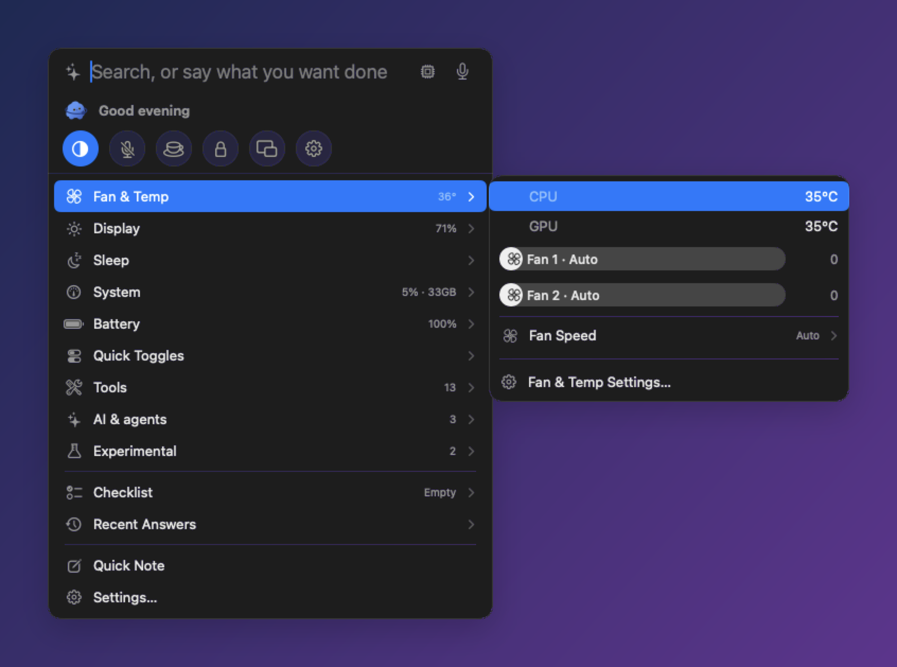
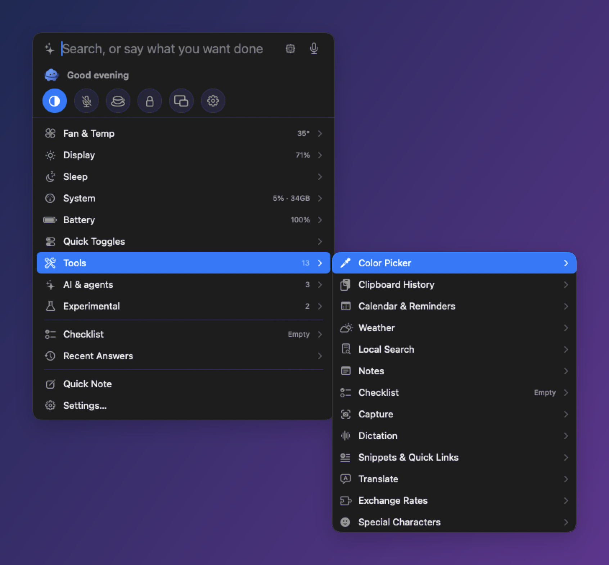
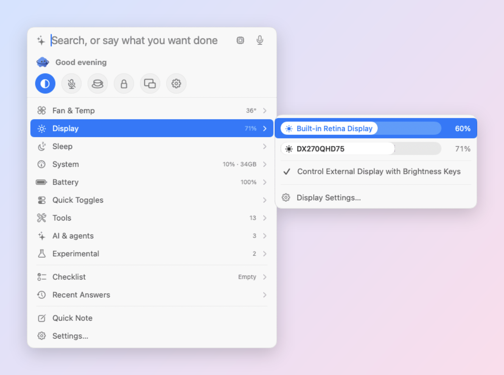
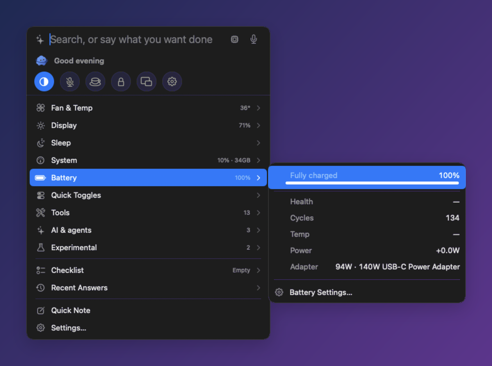
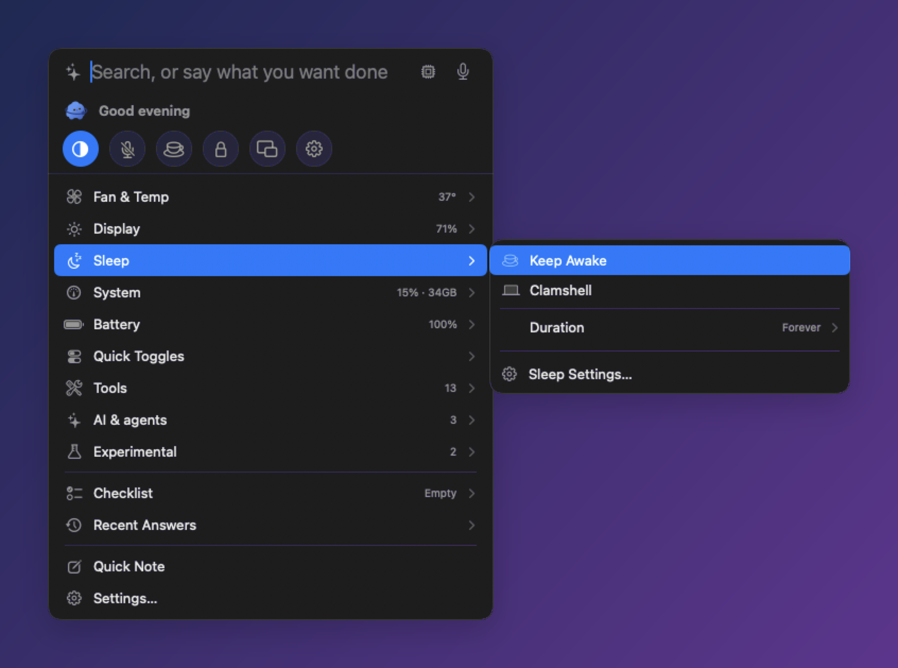
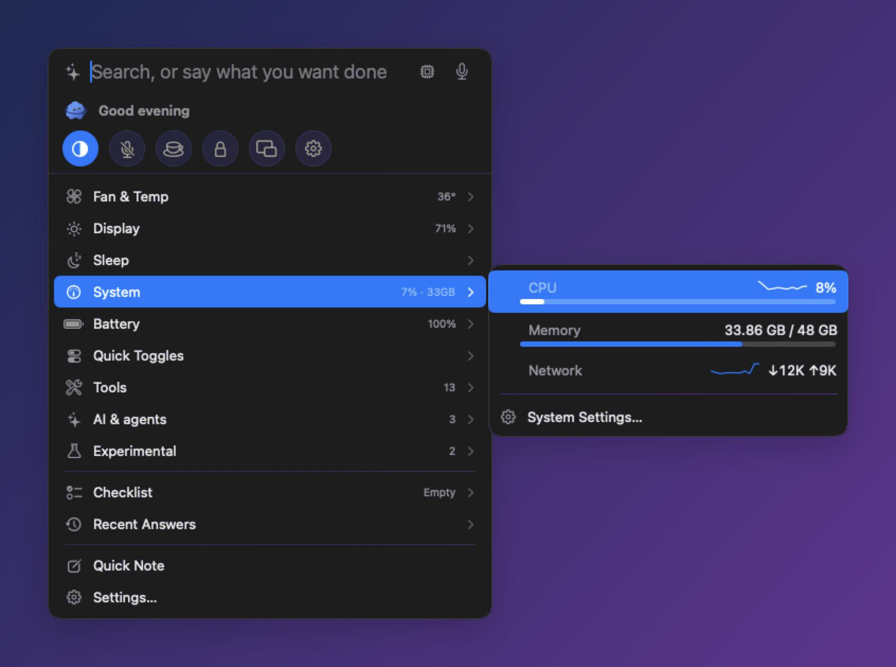
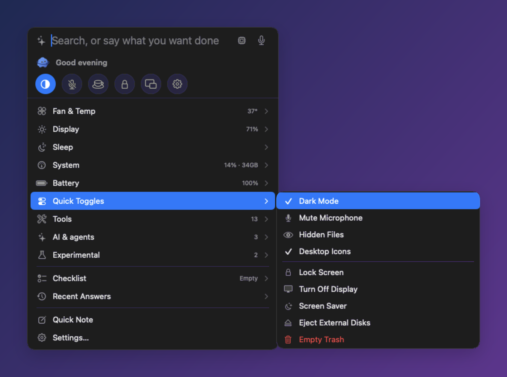
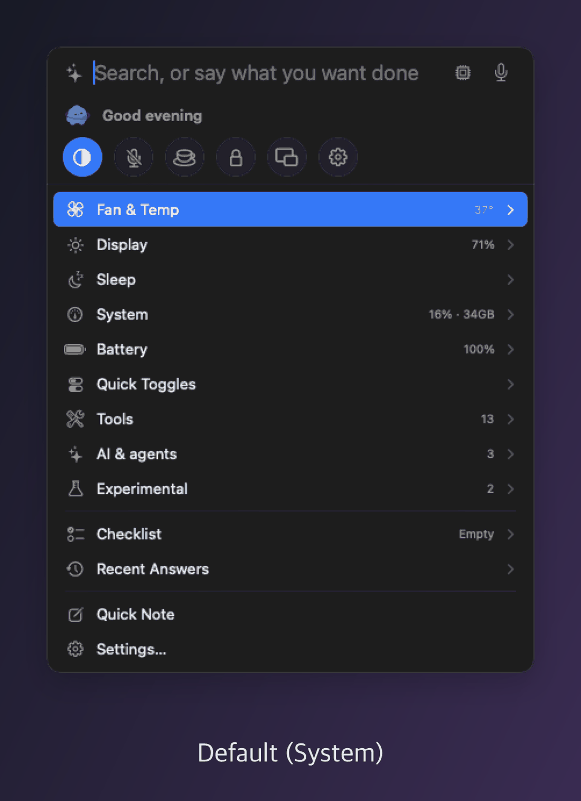
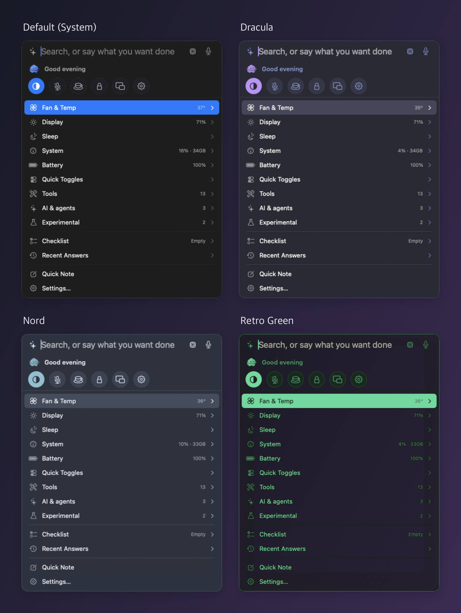

**English** · [한국어](README.ko.md)

# Divee

**Still running a dozen menu bar apps? Divee is all you need.**

Fans, brightness, key remapping, battery, keep-awake, clipboard, window snapping, capture — the jobs of a dozen apps in one free app, one ⌥Space away. 
**Claude Code & Codex usage**, **agent sessions** and **Apple's on-device AI**, right there too. 
A little mascot lives in your menu bar — Divee by default, or the cat if you prefer.

[AI built in](#-ai-built-in) · [Instant cards](#-instant-cards) · [How to use](#-how-to-use) · [Features](#-features-in-detail) · [AI assistant](#-ai-assistant) · [Themes](#-themes) · [Shortcuts](#%EF%B8%8F-shortcuts) · [devdive](#-devdive) · [Install](#-install) · [Trust](#%EF%B8%8F-built-to-be-trusted) · [Roadmap](#%EF%B8%8F-roadmap)

 

The jobs of twelve separate apps, now in one: Divee

---

## ✨ What it is

- **One ⌥Space and you're there.** Hover a row under the input field or press → and it **slides out to the side**, just like a Windows right-click menu. Up to three levels deep.
- **Fully keyboard-driven.** ↑↓ move · → open · ← back · Return run · ESC close. Sliders move with ←/→.
- **Turn on only what you need.** Pick only the modules (and plugins) you need; ones you turn off don't run at all. Out of the box only System, Battery, Fan & Temp and Checklist are on.
- **Lightweight.** About 0.2% CPU and ~42 MB of memory while the panel is closed, about 1% CPU while it's open; the app is 13 MB. Animations are native macOS ones, and you can turn them off in Settings.
- **On your Mac by default.** The AI tries on-device models first. Anything that sends data out works only when you turn it on, and Settings shows exactly what's on.

## 🧠 AI built in

If you work alongside AI on your Mac, the extra windows and apps you keep open for it fit into Divee too.

| Feature | What it does | Try |
|---|---|---|
| **AI usage** | Shows how much of your Claude Code and Codex 5-hour and weekly limits you've used, as bars — also in the menu bar and with warning colors | `claude usage`, `codex limit` |
| **Agent sessions** | Tells you which open Claude Code or Codex session is waiting for approval or has a new reply, and lets you reply right from the panel | ⌥⌘J — jump to the waiting session |
| **Just say it** | Write what you want in a sentence and Divee runs the matching feature. Tries Apple's on-device model (macOS 26+), then Ollama — on your Mac first | `make the screen dimmer`, `keep my Mac awake for 30 minutes` |
| **Sentence → card** | Sentences no rule catches go to a tiny on-device classifier (24 KB) that picks the right card and marks it **✦ On-device** | `switch to night mode`, `mute my microphone` |
| **Translation · voice input** | Apple's on-device translation (macOS 15+) and on-device speech recognition — your text and voice stay on your Mac | `안녕하세요 to English`, hold ⌃⌥Space and speak |

Cloud models are used only if you've set up a server, and only when on-device can't handle it or you say "use the cloud" (answers show ☁︎). And anything hard to undo asks first. More: [AI assistant](#-ai-assistant) · [AI & agents modules](#ai--agents)

## ⚡ Instant cards

Type a line and it turns into a card **before you press Return** — computed on your Mac, no AI needed.

| Type | Card |
|---|---|
| `3pm pst in ist`, `what time is it in tokyo` | Time zone conversion (shows next day) |
| `split 2400 between 3`, `18% of 3450`, `72f to c` | Split · percent · unit conversion |
| `days until christmas`, `100 days from now` | Dates and countdowns |
| `weather tokyo` | Weather (with the Weather module on) |
| `what's tomorrow`, `lunch with anna tomorrow` | View and add events — details open right inside the panel |
| `buy milk, eggs and bread` | Checklist → Reminders |
| `what's left`, `anything left today` | What's left today — remaining events, due reminders, agent sessions waiting for you, routine results, and calendar entries that disagree |
| `timer 25m` | Timer — time left in the menu bar; pause, extend and cancel in the panel |
| `#ff6b35`, `tiffany blue` | Color (copy HEX · RGB · HSL) |
| `what's slow`, `quit slack` | Apps using the most CPU · quit an app |
| `brightness 50`, `fans max`, `keep awake 1h` | Control a feature directly (Return to apply) |
| `claude usage`, `codex limit` | AI usage (Claude Code · Codex limits) |
| `checklist` | Checklist — the input becomes "Add item", checked items get struck through |
| `settings`, `bluetooth settings` | Open the matching System Settings pane |
| `theme nord`, `animations off` | Change Divee by typing (the mascot confirms, with undo) |
| `right command korean`, `caps tap esc hold control`, `caps lock to esc` | Key remap cards and simple remaps (Return to apply, with undo) |
| `find folders named report`, `folders created between sep 1 and sep 15` | Find files by kind · name · place · date range — shows how it understood you |
| `feedback …`, `bug …` | Send feedback — opens a pre-filled GitHub issue; nothing is sent until you submit it |

**Said it as a sentence?** When no rule matches, a tiny on-device classifier (24 KB) picks the card you most likely meant — `make the screen dimmer`, `switch to night mode`, `mute my microphone`. Those cards are marked **✦ On-device**, and if it isn't sure, no card appears.

## 🛡️ Built to be trusted

| | |
|---|---|
| **Notarized by Apple** | Signed with a Developer ID and notarized, so it opens without warnings. |
| **Background helper** | Needed only for fan control and Clamshell. It's registered through macOS's own background items, and you approve it **once** in System Settings › General › Login Items. It does exactly three things: set a fan speed / return it to automatic, toggle `pmset disablesleep`, and uninstall itself. Divee and the helper each check the other's code signature, and if Divee stops responding the helper **returns the fans to automatic and turns Clamshell off within 30 seconds.** When Divee updates, the helper updates itself — no new approval. |
| **Key rules stay local** | Keyboard rules run in a separate, sandboxed process that can't reach the network. It tells Divee only what to do ("switch input"), never which keys you pressed. |
| **Risky actions ask first** | When the AI wants to do something that can't easily be undone — open a file, run a Shortcut, click something on screen, eject disks and the like — the mascot shows what it's about to do and waits: **↩ to run, ESC to cancel.** |
| **Signed updates** | Every update and the update feed itself are signed (EdDSA). Divee tells you a new version is out, and nothing installs until you say so. |
| **What it doesn't collect** | No analytics, telemetry or ad tracking. Keystrokes are never recorded; the screen and camera are looked at once, only when you ask, and never saved. |
| **What leaves your Mac** | Only for features you turn on, only to the listed destinations — see the [Privacy](#-privacy) table. |
| **Clean removal** | Settings › Fan & Temp › **Remove Helper** restores your fan and sleep settings and deletes the helper. Then move the app to the Trash — that's it. |

## 🧭 How to use

### Opening the panel

| How | What happens |
|---|---|
| **⌥Space** | Open / close the Divee panel |
| **Click** the menu bar mascot | Opens the same panel |
| **Right-click** the menu bar mascot | Settings… · Pin floating panel · Send Feedback… · Check for Updates… · Quit Divee |

### The home list

Rows appear one per line under the input field. Dimmed text on the right is the current value; rows with `›` slide out to the side.

- **System modules** (Fan & Temp, Display, Sleep, System, Battery) are right there.
- **Quick Toggles ›** — switches like Dark Mode
- **Tools ›**, **AI & agents ›**, **Experimental ›** — the modules you've turned on, grouped by category
- **Recent Answers ›** — what you've asked the AI
- **Quick Note** · **Settings…**

### Keyboard

| Key | Action |
|---|---|
| ↑ ↓ | Move within the current column |
| → or Return | Open (moves to the first item of the flyout) |
| ← | Close one level · lower the value on a slider row |
| → (slider row) | Raise the value |
| Return | Run · toggle on/off · pick an option |
| ESC | Close the deepest flyout → clear the input → close the panel |
| ⌘↩ | Reveal an app/file search result in Finder |

### Searching

Start typing and the list turns into search results.

| Result | Description |
|---|---|
| Features | Modules you've turned on and their commands (e.g. "max fans", "brightness up") |
| AI | Ask the AI your sentence as-is |
| Apps · Files | Apps and files found with Spotlight. Sentences work too: `find folders named report`, `screenshots on my desktop from today`, `pdfs from august`, `folders created between sep 1 and sep 15` — cache and build folders are left out |
| Notes | Notes found in Apple Notes |
| Dictionary | Definitions from the macOS dictionary |
| Math | The result of an expression like `12*34` (Return copies it) |
| Web | Search the web in your browser |

## 🧰 Features in detail

Turn each module on or off in Settings › **Features**. Click a title to expand its details.

### System

<b>Fan & Temp</b> — CPU/GPU temperatures and fan speeds, with manual control <i>(on by default)</i>

- **Panel:** CPU and GPU temperatures and a slider per fan ("Fan 1" inside the bar, RPM on the right). Drag and release to put that fan in manual mode. Choose Auto · Max · Temperature curve under **Fan Speed ›**.
- **Settings:** temperature in the menu bar, warning temperature and alerts, refresh interval, min/max temperatures for the curve, install/remove the helper.
- **Ask the AI:** "How are my fans?", "Max the fans", "Put the fans back on auto", "Turn on the temperature curve"
- Reading temperatures and RPM needs no permission. **Changing fan speed** needs the background helper — approve it once in System Settings › General › Login Items.

<b>Display</b> — built-in and external display brightness

- **Panel:** a Control Center-style slider per display (display name inside the bar). External displays are controlled over DDC/CI.
- **Brightness keys for external displays:** the keyboard brightness keys (F1/F2) adjust external displays too. Requires Accessibility.
- **Settings:** auto-select the display you clicked, brightness-key control.
- **Ask the AI:** "Set brightness to 50", "What's the brightness now?"

<b>Key Remap</b> — Karabiner-style key rules, made simple

- **"What do you want to do" cards** (Settings › Key Remap) — turn one on and it works right away:
  - **Korean/English switch key, no delay** — tap Right ⌘ (or Caps Lock, Right ⌥, or a Korean keyboard's 한/영 key) to switch instantly. The first letter you type right after isn't dropped. Works with or without the system "previous input source" shortcut, and with Gureum.
  - **Caps Lock: tap = Esc, hold = Control** (or tap to switch Korean/English)
  - **Hyper key** — hold Caps Lock or Right ⌥ for ⌃⌥⇧⌘
  - **Windows keyboard** — swap ⌥ and ⌘ only on the external keyboards you pick
  - **` instead of ₩** while typing Korean
  - Per-app rules, a tap/hold threshold (default 300 ms) and a "Try it now" box
- **Keyboard picture** (Settings › Key Remap) — click a key on the drawn keyboard to pick what it does. Keys you press light up on it, and keys a card is already using are marked.
- **Type it:** `right command korean`, `caps tap esc hold control`, `caps lock hyper` — with undo.
- **Import from Karabiner:** simple modifications come in as-is; complex rules that match a card are shown for you to confirm. Shell commands and app launches are never imported, and the file is never changed.
- **Advanced:** remap any single key to another (Caps Lock → Esc, Left ⌥ ↔ ⌘, …) with macOS's built-in `hidutil`.
- **Safe by design:** keys are handled in a separate sandboxed process with no network access. Hold both ⇧ for 2 seconds to turn every rule off. If Divee quits or stops — even if you force-quit it — a tiny key guard puts the keys back to normal within a second (and the background helper does the same within 30 seconds as a backup). Rules pause in password fields. Cards need Accessibility — the same permission as the brightness keys; simple remaps need none.

<b>Battery</b> — charge, health, cycles, power <i>(on by default)</i>

- **Panel:** charging state and level bar, health · cycles · temperature · power (watts in/out) · connected adapter.
- **Settings:** full/low battery alerts, refresh interval.
- **Ask the AI:** "How's my battery?"

<b>Sleep</b> — keep awake, and stay on with the lid closed

- **Panel:** ✓ Keep Awake, ✓ Clamshell (stays on with the lid closed), **Duration ›** indefinitely · 30 min · 1 · 2 · 4 hours.
- **Settings:** custom duration, "keep the display on too".
- **Ask the AI:** "Keep my Mac awake for 30 minutes", "Don't sleep when I close the lid"
- Clamshell uses the same background helper (approve it once in Login Items), shows a heat warning when turned on, and turns itself off when Divee quits or stops responding.

<b>System</b> — CPU, memory, network, disk <i>(on by default)</i>

- **Panel:** CPU (bar + recent history graph), memory bar, network (download graph + speed), uptime, free disk space.
- **Settings:** which items appear in the panel and menu bar, CPU/memory warning thresholds, refresh interval (1 · 2 · 5 s).
- **Ask the AI:** "Why is my Mac so slow?"

<b>Quick Toggles</b> — the switches you use all the time

- **On/off:** Dark Mode · Mute Microphone · Show Hidden Files · Desktop Icons
- **Actions:** Lock Screen · Turn Display Off · Screen Saver · Eject External Disks · Empty Trash (asks first)
- **Ask the AI:** "Turn on dark mode", "Lock my screen"
- Dark Mode and Empty Trash use the Automation permission (System Events, Finder).

### Tools

<b>Clipboard History</b> — get back what you copied

- Keeps up to the last 20 texts and images; click one to copy it again (images up to 15 MB total).
- **Paste directly:** choose an item and it's pasted into the app you were using (needs Accessibility; without it, it's just copied).
- **Pin** up to 10 texts so they stay at the top and survive turning Divee off.
- **Search:** type part of a copied text in the panel and "Paste · …" results appear.
- **Paste without formatting** — a command, with its own shortcut you can set in Settings › Shortcuts.
- Command: Clear History
- **Ask the AI:** "Copy what I copied earlier again"

<b>Notes</b> — one-line quick notes (⌃⌥J)

- Press **⌃⌥J** for a one-line input; what you type goes into the "Quick Notes" note in Apple Notes with a timestamp.
- **Ask the AI:** "Find my meeting notes", "Note down what to buy tomorrow"
- Uses the Automation permission to work with Notes.

<b>Color Picker</b> — grab any color on screen (⌥⌘C)

- Pick a color anywhere on screen and copy its HEX value. The last 8 colors are kept.

<b>Special Characters</b> — frequently used symbols, one click away <i>(plugin)</i>

- Now a bundled [plugin](#plugins) — if you had it on before, it stays on.
- Click a symbol to copy it. Includes the Mac key symbols **⌘ ⌥ ⌃ ⇧ ⇪ ⇥ ⏎ ⌫ ⌦ ⎋ ⏏** — plain Unicode, so they paste into messages and docs on other systems too.
- Edit the list freely in Settings (**Restore Defaults** brings back the full list).

<b>Currency</b> — convert amounts as you type <i>(plugin, off by default)</i>

- A bundled [plugin](#plugins). Type `100 usd in krw`, `$100`, or `100달러`, `5만원 달러로` and a card shows the converted amount, or `달러 환율` for the rate.
- Rates are the European Central Bank's (via frankfurter.dev); only a currency code is sent, and rates are cached for 6 hours. Offline, the last saved rate is shown with its date.
- Choose the default currency in the plugin's settings.

<b>Checklist</b> — one simple to-do list in the panel <i>(on by default)</i>

- Type `checklist` and the input becomes "Add item"; click to check, and checked items get struck through. **Clear completed** or **Empty** the list when you're done.
- Saved only on this Mac — no sync.

<b>Window Snap</b> — snap windows to halves, quarters and thirds, Magnet-style

- **18 layouts:** left · right · top · bottom halves, four corners, thirds and two-thirds, maximize, center, restore the original place, and next / previous display.
- **Global shortcuts:** each layout has its own, Magnet-style (e.g. ⌃⌥← left half, ⌃⌥↩ maximize, ⌃⌥⌫ restore). Bottom-left has none by default because ⌃⌥J is Quick note. Change any of them in the module's settings.
- **⌥Space panel menu:** pick a layout there and it's applied to the window you were just using.
- **Saved layouts:** save where your windows are now ("Save window layout") and bring them back later ("Restore layout · name").
- Uses the Accessibility permission. Off by default.

<b>Capture</b> — screenshots, text capture and recordings

- **Panel:** Area capture · Area to clipboard · Window · Full screen · Capture toolbar · Screen recording — they use macOS's own `screencapture`.
- **Text capture:** pick an area of the screen and the text in it is read on your Mac and copied.
- **Recent captures:** open, show in Finder or copy the image. **Recent recording to GIF** converts the latest recording.
- Set shortcuts for area and text capture in Settings › Shortcuts. Requires Screen Recording. Off by default.

<b>File Conversion</b> — convert files without leaving your Mac

- **Formats:** images (HEIC · JPEG · PNG · TIFF · GIF · BMP, resize, strip metadata), PDF (merge, split, pages ↔ images), video (MOV ↔ MP4, 720p/1080p, HEVC, to GIF), audio (M4A · WAV · AIFF), documents (DOCX · RTF · HTML · TXT · Markdown) and ZIP (pack · unpack).
- **Ways in:** select files in Finder and open the panel → "File Conversion", type `png`, `merge pdf`, `mp4`, `zip` with files attached, drop files on the menu bar icon, or hold **⌃ while dragging files** for a format ring at the cursor (needs Accessibility).
- **Watch folders:** new files that land in a folder are converted automatically; originals move to an "Originals" folder.
- **Windows-friendly ZIP:** Korean (and other non-English) names stay readable on Windows — names are stored with the UTF-8 flag and no `__MACOSX` clutter, with a CP949 option for older tools. ZIPs made on Windows unpack with their names intact, and **Compose Korean Names** fixes file names that show up as separated jamo on Windows.
- Results are saved next to the originals, which are never changed. Uses only macOS's own frameworks and tools — files never leave your Mac, nothing extra to download. Off by default.

<b>Dictation</b> — hold a key and speak, anywhere

- Set a shortcut in the module's settings (there's none by default): hold it while you speak, or press once to start and again to stop (your choice). The text is pasted into the app you were in. Stops by itself after 2 minutes.
- **AI cleanup:** tidies spacing, punctuation and fillers like "um" without changing the meaning. A cloud model is used only if you allow it; otherwise, or if it takes too long, the original words are pasted.
- **Recent dictations:** the last 20 are kept in memory only; paste again or copy. Recognition happens on your Mac. Requires Microphone and Speech Recognition. Off by default.

<b>Translate</b> — on-device translation

- Type `hello 한국어로` or `안녕하세요 to English` in the panel and a translation card appears; Return copies it.
- **Translate selection:** select text in any app and use the "Translate selection" command — Return on the card replaces it, ⌘C copies it. Reading the selection needs Accessibility.
- Uses Apple's on-device Translation (macOS 15 or later), so the text never leaves your Mac. Off by default.

<b>Snippets & Quicklinks</b> — text you reuse, links you open

- **Snippets:** saved text — type its name in the panel and Return pastes it. Placeholders: `{date}` · `{time}` · `{datetime}` · `{clipboard}` · `{cursor}`.
- **Quicklinks:** a link with `{query}` — type the link's name and a search term to open it (http · https · mailto and app addresses only).
- Add and edit them in the module's settings. Off by default.

<b>Space Names</b> — name your desktops

- Give each desktop (Space) a name and click it to switch there. Show the current desktop's name in the menu bar, or turn on a floating Spaces bar.
- **Ask the AI:** "Go to desktop 2"

<b>Calendar & Reminders</b> — add events by saying so

- **Ask the AI:** "Schedule a meeting tomorrow at 3", "Remind me to buy milk", "What's on my calendar today?"
- Asks for write-only calendar access to add events, and full access separately only to read existing ones.

<b>Weather</b> · <b>Local Search</b>

- **Weather — ask the AI:** "What's the weather today?" Only the city name is sent to open-meteo.com.
- **Local Search — ask the AI:** "Find the PDF from last week" Searches Spotlight only when asked; builds no index of its own.

### AI & agents

<b>Read screen</b> · <b>Web Search</b>

- **Read screen:** reads the text of the screen or the front window from a single capture (not saved), and can find and click on-screen text — "click that button". Requires Screen Recording and Accessibility.
- **Web Search:** reads Bing results in an invisible window and returns titles, URLs and snippets.

<b>AI Usage</b> — Claude Code and Codex limits

- Shows how much of the 5-hour and weekly limits of Claude Code and Codex you've used, as bars — also in the menu bar and with warning colors.

<b>Agent Sessions</b> · <b>Hooks (automation)</b>

- **Agent Sessions:** tells you which open Claude Code / Codex sessions are waiting for approval or have a new reply, and lets you reply from the panel. ⌥⌘J jumps to a waiting session.
- **Hooks:** attach actions (command · Shortcut · open app · notification · sound · AI decision) to 14 events such as charger connected, external display connected, sleep, screen lock, battery full/low and Wi-Fi connected.

### Experimental

Appear when you turn on **Show experimental features** in Settings › Features.

<b>Motion & Knock</b> · <b>Level</b> · <b>Camera View</b>

- **Motion & Knock:** tap your MacBook (1 · 2 · 3 times) to run an action you choose. Requires Input Monitoring.
- **Level:** shows your MacBook's tilt as a spirit level.
- **Camera View:** takes one webcam look only when the AI asks, analyzes it on your Mac and never saves it.

> **Coming soon** — sillog upload and the [devdive integration](#-devdive) aren't available yet.

### Plugins

Add new features, looks and characters to Divee — **no coding needed**. See what's available at **[divee-plugins](https://github.com/dorkman43/divee-plugins)**.

| Kind | What it adds | Make one with AI |
|---|---|---|
| 🧩 Plugin | Panel commands, instant cards and AI tools (a little JavaScript) | [AI-GUIDE-plugin.md](https://github.com/dorkman43/divee-plugins/blob/main/guides/AI-GUIDE-plugin.md) |
| 🎨 Theme | Colors, font, text size, corners, spacing | [AI-GUIDE-theme.md](https://github.com/dorkman43/divee-plugins/blob/main/guides/AI-GUIDE-theme.md) |
| 🐾 Mascot | Your own menu bar character — shows up next to Divee and the cat | [AI-GUIDE-mascot.md](https://github.com/dorkman43/divee-plugins/blob/main/guides/AI-GUIDE-mascot.md) |

1. **Make one:** open the AI guide, paste the whole file into an AI chat (Claude, ChatGPT, Gemini …) and say what you want — *"a card that turns '3 miles' into km"*, *"a theme like Dracula"*. The AI gives you a folder. Or download a ready-made one from [divee-plugins](https://github.com/dorkman43/divee-plugins).
2. **Install:** Settings › **Plugins** › **Install from Folder…** → choose that folder. A plugin lists the permissions it needs (for example, which web address it may reach) before it's installed. Themes and mascots are data only; a theme that brings its own fonts asks before using them.
3. **Manage:** turn each one on or off, or remove it, on the same page. If something's wrong, press **Copy Fix Request for AI** and paste it back into the chat.

Special Characters and Currency come built in as plugins — turn them on in the same list.

**Devices at home:** a plugin can talk to a NAS, router, Home Assistant or a server on your Mac only if it lists that exact device (`localNetwork`). You'll see a ⚠︎ line for each device before you allow it, and macOS asks for Local Network access the first time.

**Safety:** a plugin can open a link or write to the clipboard only when you run its command. Installing a folder over an installed plugin always asks (and warns if an API key is saved for it), and if a plugin's files change after you approved it, Divee asks again. Confirmation prompts always use the system font.

## 🤖 AI assistant

Write what you want done in plain language and the AI runs the matching features of the modules you've turned on. The "Ask the AI" examples above show what each module can do.

| Backend | Runs on | Notes |
|---|---|---|
| **Local-first** (default) | Your Mac | Apple on-device → Ollama; hands off to your chosen server only when needed or when you say "use the cloud". Handed-off answers are marked ☁︎ |
| Apple on-device | Your Mac | Apple Intelligence model. macOS 26 or later |
| Ollama | Your Mac | Ollama models running locally |
| OpenAI-compatible server | The server you choose | OpenAI · OpenRouter · Groq · LM Studio and more. Remote servers need https (http only for servers on this Mac). API key stored in the Keychain, separately per server address |

- **Voice input:** hold ⌃⌥Space and speak; your words go into the input field. Recognition happens on your Mac.
- **Recent Answers:** requests keep running even after you close the panel, and results stay in "Recent Answers".

## 🔗 devdive

<table><tr><td>

**[devdive](https://devdive.ai)** is *the AI partner that transforms how you work* — a workspace that brings AI tools for images, video and speech together with AI workflows you can share with your teammates to cut down on repetitive work. It's made by the same team as Divee.

</td></tr></table>

**In Divee (coming soon)** — connects through the devdive plugin. Turn it on and, right from the ⌥Space panel:

- **"Draw a cat"** — generate images
- **"Make a video of the ocean"** — generate video
- **"Read this sentence aloud"** — generate speech
- **"How many devdive credits do I have left?"** — check credits

Your devdive API key is stored only in your Mac's Keychain, and a confirmation card appears before anything runs. Each generation uses devdive credits.

## 🎨 Themes

Pick one in Settings › General › **Theme** — it applies instantly. Themes cover the panel, flyouts, floating panel and speech bubble.

All four themes at a glance

## ⌨️ Shortcuts

| Shortcut | Action |
|---|---|
| **⌥Space** | Open the Divee panel |
| **⌃⌥Space** | Hold to talk |
| ⌃⌥J | Quick note |
| ⌥⌘C | Pick a color on screen |
| ⌥⌘O | Collapse / expand the floating panel |
| ⌥⌘J | Jump to a waiting agent session |
| ⌃⌥ + arrows / letters | Window Snap layouts (e.g. ⌃⌥← left half, ⌃⌥↩ maximize) |

Change any shortcut in Settings › Shortcuts.

## ⚙️ Settings

- **Features:** modules grouped into System · Tools · AI & agents · Experimental. You can open a module's settings even before turning it on.
- **General:** AI backend, voice input, **Show in menu bar** (up to 2 modules, so the notch doesn't hide them), **Animations**, Theme.
- **Plugins:** add, remove and turn on or off plugins, theme packs and mascot packs.
- **Permissions:** see at a glance what's allowed and jump straight to granting it.
- **About:** what currently sends data out, **export/import settings** (a single JSON file), update checks, **Send feedback…**, replay the welcome guide.

## 📦 Install

1. Download [**Divee.dmg**](https://github.com/dorkman43/divee/releases/latest/download/Divee.dmg).
2. Open the DMG and drag **Divee** into **Applications**.
3. Launch Divee — the mascot appears in your menu bar and a short welcome guide shows once. Pick what you want (Battery & Heat / Display & Windows / Tools / AI Assistant) and the matching modules turn on.

It's notarized by Apple, so it opens without the "unidentified developer" warning.

**Updates:** Divee checks once a day (turn it off in Settings › About). When a new version is out, a small dot appears on the menu bar mascot and it tells you — nothing installs until you click **Install**. If you're on 1.0.0, download the new version from the link above just this once.

**Used fan control or Clamshell before 1.0.5?** The helper now uses macOS's background items. Open Settings › Fan & Temp, click **Move helper to the new method**, then turn Divee on in System Settings › General › Login Items. From 1.0.6 on, the helper updates itself along with Divee.

**Requires:** macOS 14 Sonoma or later on an Apple Silicon Mac (M1 or later)

### Permissions

Divee asks only for what the features you turn on need, and says why.

| Permission | Used by |
|---|---|
| Accessibility | Key remap cards, switching Spaces, brightness keys for external displays, clicking on-screen text, Window Snap, paste directly, translate selection |
| Screen Recording | Read screen, Capture |
| Calendars · Reminders | Checking and adding events |
| Microphone · Speech Recognition | Voice input and Dictation (only while held) |
| Automation | Notes, Dark Mode toggle · Empty Trash |
| Input Monitoring | Motion & Knock, Level (experimental) |
| Camera | Camera View (experimental) |
| Notifications | Battery and fan alerts, Hooks |
| Login Items approval (once) | The background helper for fan control and Clamshell |

### Uninstall

If you used fan control or Clamshell, click **Remove Helper** in Settings › Fan & Temp first. Then quit Divee and move it to the Trash.

## 🔒 Privacy

Divee works **on your Mac only** by default. Data leaves your Mac only when you turn on one of the features below, and Settings › About lists exactly what's on.

| Feature | What is sent | Where |
|---|---|---|
| Weather | City name | open-meteo.com |
| Web Search | Search query | Bing |
| AI Usage | Your usage lookup (Codex) | OpenAI servers |
| A remote AI backend you chose | Your sentence | The server you chose |
| Update check (once a day, can be off) | App version (request header) | GitHub |
| Send feedback (only when you submit) | What you wrote + Divee version, macOS version, chip | A GitHub issue, in your browser |
| Currency plugin (only when on) | A currency code | api.frankfurter.dev |
| devdive plugin (coming soon, only when on) | Generation requests (prompts, text) | devdive servers |

Read screen and the camera look at a single frame and never save it. Accelerometer readings are discarded right after use, and keystrokes are never collected.

## 🗺️ Roadmap

No dates promised — the order may change based on your [feedback](#-feedback).

| Status | What |
|---|---|
| 🔨 In progress | **devdive plugin** — generate images, video and speech from the panel, check credits |
| 🔨 In progress | **Formatted AI answers** — render Markdown such as tables and bold text |
| 📝 Planned | **devdive MCP** — use devdive's generation, analysis and workflows right inside Claude, ChatGPT and other AI apps |
| 📝 Planned | **Divee MCP** — expose Divee's features as an MCP server for Claude, Cursor and other AI tools, and connect other MCP servers to Divee's AI |
| 📝 Planned | **devdive workflows** — run workflows saved in devdive as Divee commands and AI tools |
| 📝 Planned | **MQTT plugin** — send commands to devices at home, such as Home Assistant |
| 📝 Planned | **Instant cards + local model** — turn more kinds of sentences into cards with a model on your Mac |
| 🤔 Considering | **Window tidying** — arrange scattered windows in one go (currently turned off) |

## 👋 Made by

Divee is made by the devdive team at **[Gendive](https://www.gendive.kr)**, an AI company on a mission to *break down the barriers between technology and ideas*. Gendive builds the AI workspace [devdive](https://devdive.ai), creates AI training data and runs hands-on AI training.

## 💬 Feedback

Bug reports and suggestions are welcome. Right-click the menu bar mascot › **Send Feedback…**, or type `feedback …` in the ⌥Space panel — it opens a pre-filled [GitHub issue](https://github.com/dorkman43/divee/issues) with your Divee and macOS versions and chip type (nothing else), and you submit it yourself.

## ☕ Support

Divee is free and stays free. If it replaced a few paid apps on your Mac, you can [chip in what you like](https://pay.devdive.ai/checkout/buy/dbd26817-d019-4404-b052-c1ff8ce8ae5d) — right-click the menu bar mascot › **Buy Me a Coffee…** gets you there too.

© 2026 dorkman43 · Divee is free to use.

